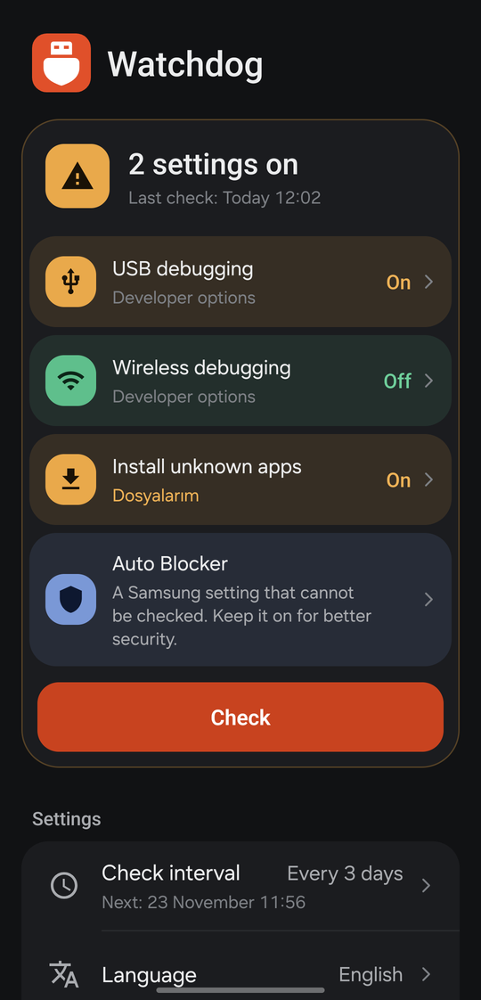
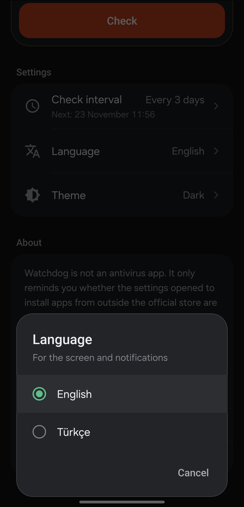

# Watchdog: Security Reminder

[Türkçe](README.tr.md)

### [⬇ Download for Android (Watchdog.apk)](https://github.com/SCgrS/Watchdog/releases/latest/download/Watchdog.apk)

Watchdog is a small **Android app that reminds you of settings you left on** after installing an APK: USB and wireless
debugging, and apps allowed to install unknown apps. It also reminds you of Samsung's Auto Blocker you turned off.

To install an APK from outside the Play Store on a Samsung phone, you turn off Auto Blocker, turn on USB debugging or
allow an app such as the browser or My Files to install unknown apps. Once the install is done, turning them back is
easy to forget, and the phone stays unprotected for days. Watchdog checks these settings at the interval you choose
(weekly by default) and reminds you with a notification if one is still on. Tapping the notification opens the app. You
turn the settings off yourself: The app cannot change any setting.

  
  

## Installation

Requirements: Android 12 or later. Auto Blocker exists only on Samsung phones (One UI 6 and later). On other phones the
app watches the debugging settings and Install unknown apps.

1. Download `Watchdog.apk` from the link above on your phone.
2. On a Samsung phone, turn off **Settings › Security and privacy › Auto Blocker**. While it is on, APKs from outside
   the Play Store cannot be installed.
3. Open the file and install it. If the phone asks for permission to install from this source, allow it. Watchdog will
   remind you to turn this permission off again. If Google Play Protect warns about an unknown app, open the details and
   choose **Install anyway**. The warning appears because the app does not come from the Play Store.
4. Open Watchdog and allow notifications.
5. As the app suggests, choose **App info › Battery › Unrestricted**. Otherwise Samsung can put the app to sleep and
   reminders will not arrive.
6. Turn Auto Blocker back on.

The APK is signed with Watchdog's release key. The SHA-256 fingerprint of its certificate is
`32:03:63:47:A0:5B:5C:D3:BA:28:58:37:D7:E4:5A:7C:51:9F:B4:15:E2:FF:62:2E:BE:5B:25:F5:2C:3D:10:6E`.

To build the app from its source code, see [docs/DEVELOPMENT.md](docs/DEVELOPMENT.md).

## Highlights

- **Hard rule:** The app cannot change any setting. It has no `WRITE_SECURE_SETTINGS` permission, no accessibility
  service, no device admin, no Shizuku, no root and no `INTERNET` permission. It only reads settings, shows a
  notification and opens the matching settings page. You turn the settings off yourself. It asks for only two
  permissions: Showing notifications and setting up the check again when the phone starts.
- **Three settings:** You choose the check interval (from every hour to every week), the language (English or
  Turkish) and the theme (light, dark or following the phone).
- **Quiet when off:** The notification goes away as soon as you turn the setting off. For Install unknown apps, it goes
  when you come back to Watchdog.
- **Light:** It does not run in the background all the time. The system wakes it for a moment at check time. The package
  is about 85 KB and depends on no other library.

## What it does

### Checks

When the interval you chose is over, the app looks at USB debugging, wireless debugging and Install unknown apps. If one
is on, a notification appears. Its title names the setting that is on, or says how many are on. Tapping the notification
or its **Show details** button opens Watchdog: The settings and Auto Blocker are on the same screen, so Auto Blocker is
not forgotten while you turn the settings off. Tapping a setting's row on the screen opens that setting. The
notification stays until you turn the setting off and alerts you again at every interval. If the phone is off at that
time, the check runs when it starts. After a restart the notification comes back silently.

No notification appears while you change settings or when you open the app. The app alerts you only when the interval
is over.

Developer options itself is not watched. Leaving it on is not a risk by itself, the reminder is about the debugging
settings.

### Install unknown apps

Since Android 8, installing unknown apps is allowed per app, in **Settings › Apps › ⋮ › Special access › Install unknown
apps**. When you open an APK in the browser, My Files or WhatsApp, the phone asks you to allow that app, and the
permission stays on afterwards. Watchdog looks at the apps with an icon in the app list and names the ones that are
still allowed, on the screen and in the notification ("Install unknown apps (Chrome)"). Tapping the row opens that
app's switch, or the list when there are several. The phone's own app stores, which install without asking, are not
counted.

Android does not tell an app when this permission changes. After you turn it off, the notification goes away when you
come back to Watchdog or at the next check.

### Manual check

The **Check** button on the main screen looks at the settings right away and tells the result in a short message (such
as "Checked: USB debugging on"). If a setting is on, the notification appears silently. The next check moves to one
interval from that moment.

### Auto Blocker

Android does not let apps read Auto Blocker's status. So the reminder works like this: As soon as you turn the settings
left on off, a silent "Turn on Auto Blocker now" notification appears (whether or not you saw the reminder). Tapping it
opens the Auto Blocker page and closes the notification. This reminder comes once. On phones where the status can be
read, Auto Blocker being off is also reminded when the interval is over.

### Main screen

The main screen puts the status first: A card that says how many settings are on, when the last check was, one
colored row per setting (amber left on, green off, blue for Samsung's Auto Blocker, which cannot be read) and the
**Check** button. Below are Settings (check interval with the next check, language, theme) and About (what the app is
and is not, its version and the developer). Every row that can be tapped has a chevron on the right. Tapping a setting's
row opens that setting, and for USB and wireless debugging the page scrolls straight to it. If the app is restricted in
battery settings, or if Android may pause an app that is not opened for a long time, the main screen says so and opens
the right settings page.

### Language and theme

The app can be used in English and Turkish. The default is English, whatever the phone's language. Change it in the
**Settings › Language** row on the main screen. The screen and the notifications switch to the chosen language.

The screen follows the phone's light or dark mode. **Settings › Theme** can fix it to light or dark.

## Updating

The app does not update itself. Download the APK of the new version and install it over the old one. Your settings are
kept.

## Privacy

The app has no internet permission, no data leaves the phone. To see which apps may install unknown apps, it looks at
the apps on the phone during a check. That list is not stored. The phone keeps only the interval, language and theme you
chose, the time of the last and the next check, whether notification permission was asked and whether an Auto Blocker
reminder is waiting. This record is not backed up to the cloud and is not moved to a new phone. There is no telemetry.

## Third-party components

Watchdog uses Android's own classes and the Kotlin standard library (JetBrains, Apache-2.0). It depends on no other
package. Its icons are from Material Icons (Google, Apache-2.0).

## Automated checks

\

---

Questions and feedback: [x.com/CgrShn](https://x.com/CgrShn)

License: AGPL-3.0. See the [LICENSE](LICENSE) file for details.
