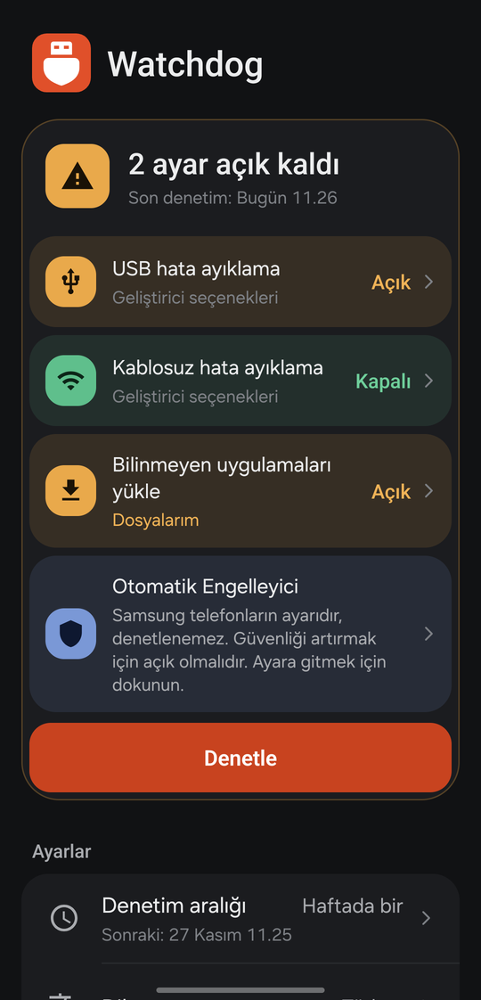
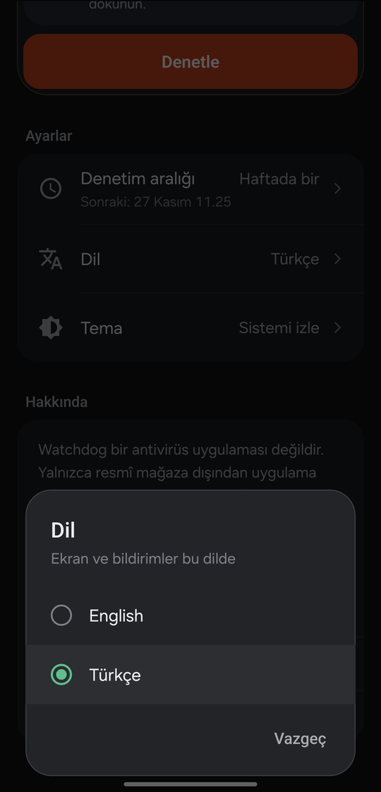

# Watchdog

[English](README.md)

### [⬇ Android için indir (Watchdog.apk)](https://github.com/SCgrS/Watchdog/releases/latest/download/Watchdog.apk)

Watchdog, APK kurmak için açılan hata ayıklama ayarlarını, uygulamalara verilen bilinmeyen uygulama yükleme iznini ve
kapatılan Otomatik Engelleyici'yi unutmamanız için **hatırlatma yapan küçük bir Android uygulamasıdır**.

Samsung telefonda dışarıdan APK kurmak için Otomatik Engelleyici kapatılır, USB hata ayıklama açılır ya da tarayıcı,
Dosyalarım gibi bir uygulamaya bilinmeyen uygulama yükleme izni verilir. Kurulum bitince bunları geri almak çoğu zaman
unutulur ve telefon günlerce korumasız kalır. Watchdog seçtiğiniz aralıkta (varsayılan haftada bir) bu ayarlara bakar,
açık kalan varsa bildirimle hatırlatır. Bildirime dokununca uygulama açılır. Ayarları kapatmayı siz yaparsınız: Uygulama
hiçbir ayarı değiştiremez.

  
  

## Kurulum

Gereksinim: Android 12 ya da sonrası. Otomatik Engelleyici yalnız Samsung telefonlarda (One UI 6 ve sonrası) vardır, öbür
telefonlarda uygulama hata ayıklama ayarlarını ve bilinmeyen uygulama yükleme iznini izler.

1. Yukarıdaki bağlantıdan `Watchdog.apk` dosyasını telefona indirin.
2. Samsung telefonda **Ayarlar › Güvenlik ve gizlilik › Otomatik Engelleyici**'yi kapatın. Açıkken dışarıdan APK kurulmaz.
3. Dosyayı açıp kurun. Telefon bu kaynaktan kurulum için izin isterse verin. Bu izni yeniden kapatmanızı Watchdog
   hatırlatır. Google Play Protect bilinmeyen uygulama uyarısı verirse ayrıntıları açıp **Yine de yükle**'yi seçin.
   Uyarı, uygulama Play Store'dan gelmediği için çıkar.
4. Watchdog'u açın ve bildirimlere izin verin.
5. Uygulamanın önerdiği gibi **Uygulama bilgileri › Pil › Kısıtlanmamış**'ı seçin. Yoksa Samsung uygulamayı uyutabilir ve
   hatırlatmalar gelmez.
6. Otomatik Engelleyici'yi yeniden açın.
7. Uygulama İngilizce açılır. Türkçe için ana ekranda **Settings › Language**'e dokunup **Türkçe**'yi seçin.

APK, Watchdog'un yayım anahtarıyla imzalıdır. Sertifikasının SHA-256 parmak izi
`32:03:63:47:A0:5B:5C:D3:BA:28:58:37:D7:E4:5A:7C:51:9F:B4:15:E2:FF:62:2E:BE:5B:25:F5:2C:3D:10:6E`.

Uygulamayı kaynak kodundan derlemek için [docs/DEVELOPMENT.md](docs/DEVELOPMENT.md) dosyasına bakınız.

## Öne çıkanlar

- **Kesin kural:** Uygulama hiçbir ayarı değiştiremez. `WRITE_SECURE_SETTINGS` izni, erişilebilirlik servisi, cihaz
  yöneticisi, Shizuku, root ve `INTERNET` izni yoktur. Ayarları yalnızca okur, bildirim gösterir ve ilgili ayar
  sayfasını açar. Kapatmayı siz yaparsınız. Yalnız iki izin ister: Bildirim göstermek ve telefon açılınca denetimi
  yeniden kurmak.
- **Üç ayar:** Denetim aralığını (saatte bir ile haftada bir arası), dili (İngilizce ya da Türkçe) ve temayı (açık,
  koyu ya da telefonu izleyen) seçersiniz.
- **Kapanınca susar:** Ayarı kapattığınız anda bildirim kalkar. Bilinmeyen uygulama yükleme izninde Watchdog'a
  döndüğünüzde kalkar.
- **Az kaynak:** Arka planda sürekli çalışmaz. Sistem denetim anında uygulamayı kısa bir an uyandırır. Paket yaklaşık 85 KB'tır,
  başka bir kütüphaneye bağlı değildir.

## Ne yapar

### Denetim

Uygulama seçtiğiniz aralık dolunca USB hata ayıklamaya, kablosuz hata ayıklamaya ve bilinmeyen uygulama yükleme iznine
bakar. Biri açıksa bildirim gelir. Bildirimin başlığı açık olan ayarı ya da kaç ayarın açık olduğunu söyler. Bildirime
ya da bildirimdeki **Ayrıntıları göster** düğmesine dokununca Watchdog açılır: Ayarlar ve Otomatik Engelleyici aynı
ekranda görünür, ayarları kapatırken Otomatik Engelleyici unutulmaz. Ekranda bir ayarın satırına dokununca o ayar
açılır. Ayarı kapatana dek bildirim yerinde kalır, her aralıkta yeniden uyarır. Telefon o sırada kapalıysa denetim
açılınca yapılır. Telefon yeniden başlayınca bildirim sessizce geri gelir.

Ayar açarken ya da uygulamayı açtığınızda bildirim gelmez. Uygulama yalnız aralık dolunca uyarır.

Geliştirici seçeneklerinin kendisi izlenmez. Açık kalması tek başına risk değildir, uyarı hata ayıklama ayarları içindir.

### Bilinmeyen uygulamaları yükle

Android 8'den beri bilinmeyen uygulama yükleme izni uygulama başına verilir: **Ayarlar › Uygulamalar › ⋮ › Özel erişim ›
Bilinmeyen uygulamaları yükle**. Tarayıcıda, Dosyalarım'da ya da WhatsApp'ta bir APK açınca telefon o uygulamaya izin
vermenizi ister ve izin sonra da açık kalır. Watchdog uygulama listesinde simgesi olan uygulamalara bakar, izni hâlâ
açık olanları ekranda ve bildirimde adıyla söyler ("Bilinmeyen uygulamaları yükle (Chrome)"). Satıra dokununca o
uygulamanın anahtarı, birden çok uygulama varsa liste açılır. Telefonun kendi uygulama mağazaları sormadan kurduğu için
sayılmaz.

Android bu izin değişince uygulamalara haber vermez. İzni kapattıktan sonra bildirim Watchdog'a döndüğünüzde ya da
sonraki denetimde kalkar.

### Elle denetim

Ana ekrandaki **Denetle** düğmesi ayarlara hemen bakar ve sonucu kısa bir iletiyle söyler ("Denetlendi: USB hata ayıklama
açık" gibi). Açık ayar varsa bildirim sessizce gelir. Sonraki denetim o andan bir aralık sonraya kayar.

### Otomatik Engelleyici

Android, Otomatik Engelleyici'nin durumunu uygulamalara okutmuyor. Bu yüzden hatırlatma şöyle yapılır: Açık kalan
ayarları kapattığınız anda sessiz bir "Şimdi Otomatik Engelleyici'yi açın" bildirimi gelir (hatırlatmayı görmüş olun ya
da olmayın). Dokununca Otomatik Engelleyici sayfası açılır ve bildirim kapanır. Bu hatırlatma bir kez gelir. Durumu
okunabilen telefonlarda kapalı Otomatik Engelleyici aralık dolunca ayrıca hatırlatılır.

### Ana ekran

Ana ekranda önce durum gelir: Kaç ayarın açık kaldığını ve son denetimin ne zaman yapıldığını söyleyen bir kart, her
ayar için renkli bir satır (açık kalan turuncu, kapalı yeşil, durumu okunamayan Otomatik Engelleyici mavi) ve
**Denetle** düğmesi. Altında Ayarlar (sonraki denetimle birlikte denetim aralığı, dil, tema) ve Hakkında (uygulamanın ne
olduğu ve ne olmadığı, sürümü ve geliştiricisi) bölümleri vardır. Dokunulabilen her satırın sağında ok vardır. Bir
ayarın satırına dokununca o ayar açılır, USB ve kablosuz hata ayıklamada sayfa doğrudan o ayara kayar. Pil ayarında
uygulama kısıtlanmışsa ya da Android uzun süre açılmayan uygulamayı duraklatabilecekse ana ekran bunu söyler ve ilgili
ayar sayfasını açar.

### Dil ve tema

Uygulama İngilizce ve Türkçe kullanılabilir. Varsayılan dil İngilizcedir, telefonun dili ne olursa olsun İngilizce açılır.
Dil ana ekrandaki **Ayarlar › Dil** satırından değiştirilir. Ekran ve bildirimler seçilen dile geçer.

Ekran telefonun açık ya da koyu moduna uyar. **Ayarlar › Tema** ile hep açık ya da hep koyu yapılabilir.

## Güncelleme

Uygulama kendini güncellemez. Yeni sürümün APK'sını indirip eskisinin üstüne kurun, ayarlarınız korunur.

## Veri gizliliği

Uygulamanın internet izni yoktur, hiçbir veri telefondan çıkmaz. Hangi uygulamaların bilinmeyen uygulama
yükleyebildiğini görmek için denetim anında telefondaki uygulamalara bakar, bu liste saklanmaz. Telefonda yalnız
seçtiğiniz aralık, dil ve tema, son ve sonraki denetim zamanı, bildirim izninin sorulup sorulmadığı ve bekleyen bir
Otomatik Engelleyici hatırlatması olup olmadığı saklanır. Bu kayıt buluta yedeklenmez ve yeni telefona aktarılmaz.
Telemetri yoktur.

## Üçüncü taraf bileşenler

Watchdog Android'in kendi sınıflarını ve Kotlin'in standart kütüphanesini (JetBrains, Apache-2.0) kullanır. Başka hiçbir
pakete bağlı değildir. Simgeleri Material Icons'tandır (Google, Apache-2.0).

## Otomatik denetimler

\

---

Soru ve geri bildirimler için: [x.com/CgrShn](https://x.com/CgrShn)

Lisans: AGPL-3.0. Ayrıntılar için [LICENSE](LICENSE) dosyasına bakınız.
